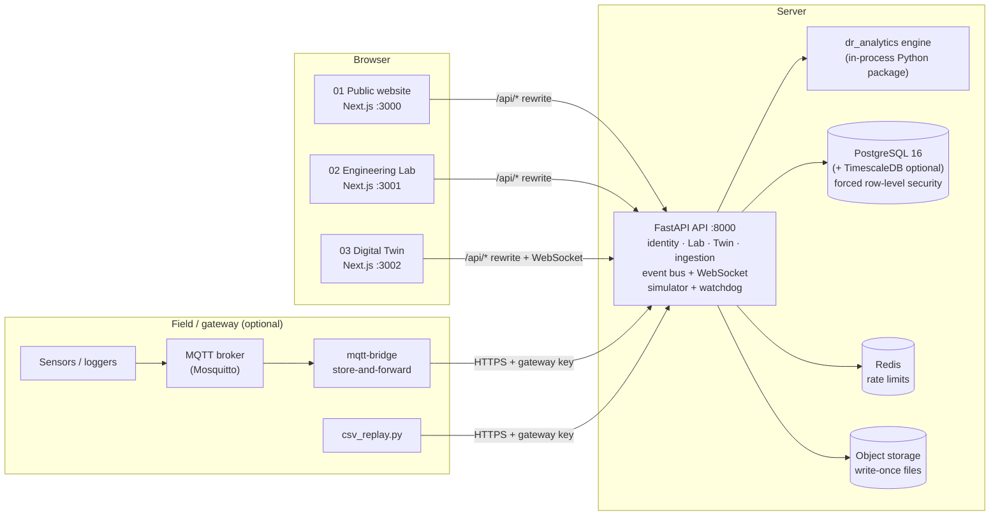
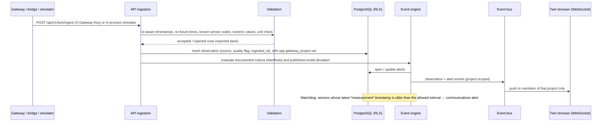
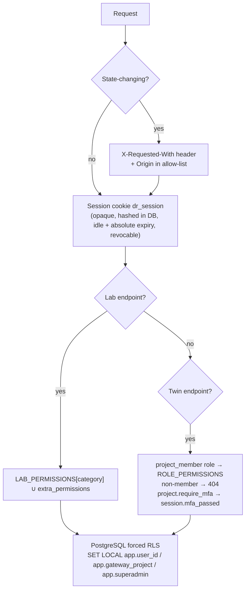
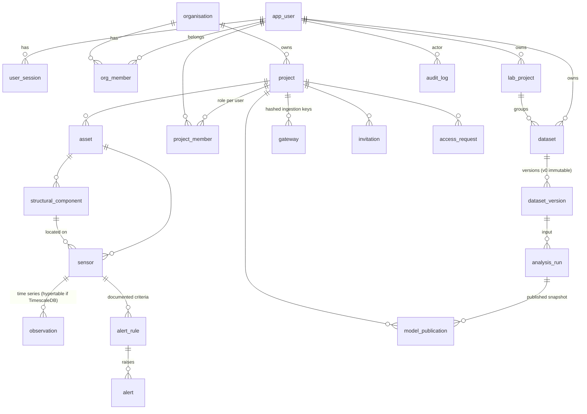

# Digital Reservoir: architecture

This page describes what is in the repository now (Stages 1–7). The parts that are planned but not yet built are listed in [ROADMAP.md](ROADMAP.md).

## 1. System overview



| App | Path | Default URL | Access | Theme (`data-app`) |
|---|---|---|---|---|
| Public website | `apps/public-website` | http://localhost:3000 | Open; statically pre-rendered; SEO metadata, sitemap and robots | `public`: ivory, navy and teal |
| Engineering Lab | `apps/engineering-lab` | http://localhost:3001 | Registered users with a verified email; permissions by membership category | `lab`: light analytical workspace |
| Digital Twin | `apps/digital-twin` | http://localhost:3002 | Per-project membership (invitation or approved request); MFA-verified session | `twin`: dark technical |

How the apps reach the API:

- Each app forwards `/api/*` to `DR_API_INTERNAL_URL`. The browser therefore talks to one origin per app, and the session cookie is first-party.
- In production the three apps run on subdomains (for example `www.`, `lab.` and `secure.`), and `DR_COOKIE_DOMAIN` set to the parent domain gives single sign-on.
- The domain names are only configuration (`NEXT_PUBLIC_*_URL`). Nothing in the code assumes a particular domain is registered.

## 2. Monorepo

```
apps/            public-website · engineering-lab · digital-twin
packages/        design-system (tokens, logo, badges, AppSwitcher) · shared-types · authentication (client helpers) · shared-utilities (+ tests)
services/api     FastAPI: app/{config,db,models,models_twin,security,deps,rls,audit,emailer,storage,report,cli}.py,
                 app/routers/{auth,public,lab,admin,twin,integration}.py, app/twin/{access,bus,engine,simulator}.py, migrations/ (Alembic 0001–0003)
services/analytics-engine   dr_analytics: common, io, quality, signal_proc, stats, hst, ml, anomaly, dhi, hybrid, fragility, modal, vision
services/data-ingestion     mqtt_bridge.py (MQTT → REST, spool on failure), csv_replay.py
services/realtime-service   placeholder; real-time fan-out currently runs inside the API process (see §5)
infrastructure/  docker/ (api, web, bridge Dockerfiles; entrypoint; mosquitto.conf) · database/01-app-role.sh
datasets/        synthetic datasets + generate_synthetic.py
```

## 3. Data flow: Digital Twin



Every observation records:

- timestamp (UTC, timezone-aware);
- project, asset, sensor;
- value and unit;
- `source` (`live | historical | simulated | imported`);
- quality flag;
- `ingested_at`.

What the dashboards show:

- Each value is displayed with its source, its timestamp and its quality flag.
- A condition is shown only when a documented criterion exists. Without one, the value is shown as **"not assessed"**.
- A criterion marked as a demonstration is labelled as illustrative.

## 4. Data flow: Engineering Lab and integration

```mermaid
flowchart LR
  U["Upload CSV/XLSX<br/>or synthetic sample<br/>or Twin export"] --> V0["Dataset version 0<br/>(immutable original, SHA-256)"]
  V0 --> Q["Quality / processing steps"] --> V1["New dataset version<br/>+ processing history"]
  V1 --> AN["Analysis run<br/>(signal, statistics, HST, ML, anomaly,<br/>DHI, hybrid, modal, fragility, vision)"]
  AN --> RES["Stored result + parameters + dataset version<br/>+ engine version → HTML report / CSV"]
  RES -- "models_publish + Twin project role" --> PUB["Model publication<br/>(immutable snapshot in Twin project)"]
  PUB --> DEV["Deviation alerts on new observations<br/>and evaluation over a period"]
  TW["Twin monitoring data"] -- "export permission + Lab access" --> U
```



Every analysis run stores the information needed to reproduce it:

- the dataset version;
- the parameters;
- the engine version;
- the time it ran.

Results are returned with any warnings. For example, extrapolation outside the calibration range, too few samples, or MAPE not shown because values are close to zero.

## 5. Identity, authorisation and isolation



How identity works:

- **Passwords:** hashed with Argon2id. The password policy is checked on the server.
- **Lockout and rate limits:** an account is locked after `DR_MAX_FAILED_LOGINS` failed attempts. Login and ingestion are rate-limited, in Redis when configured and in memory otherwise.
- **MFA:** TOTP, with the secret encrypted at rest using a key derived from `DR_SECRET_KEY`.
- **Sessions:** the cookie is HttpOnly and SameSite=Lax, and Secure in production. Signing out, changing the password or a role, or losing membership revokes it.

How authorisation works:

- **Twin roles:** `project_admin`, `project_engineer`, `researcher`, `monitoring_operator` and `viewer`, mapped to the permissions `view`, `export`, `alert_ack`, `sensors_manage`, `criteria_edit`, `members_manage` and `models_publish`.
- **Admins:** the platform superadmin, and institutional admins of the organisation that owns the project, act as `project_admin`.
- **WebSocket:** the stream re-checks the session and membership every 30 seconds.

How isolation works (a second line of defence):

- Row-level security is **forced** on seven tables: `asset`, `structural_component`, `sensor`, `observation`, `alert_rule`, `alert` and `model_publication`.
- The context is set per transaction by a SQLAlchemy `after_begin` hook (`app/rls.py`).
- The application role must be **NOSUPERUSER NOBYPASSRLS** (`dr_app`); otherwise PostgreSQL ignores the policies. Migrations run as the separate owner role.

Every security-relevant event is written to the audit log:

- logins and failed logins;
- MFA changes;
- denied access;
- invitations and role changes;
- exports;
- model publications.

## 6. Entity relationships (main tables)



`email_outbox`, `one_time_token` (email verification and password reset) and `contact_message` support the identity and public endpoints. The full schema is in `services/api/migrations/versions/`.

## 7. Analytics engine (`services/analytics-engine/dr_analytics`)

| Module | Methods |
|---|---|
| `quality` | Missing values, duplicates, timestamp regularity, gaps, Hampel and global-MAD outlier tests, resampling, unit conversion |
| `signal_proc` | Baseline and detrend, moving average, zero-phase Butterworth filters (SOS, `sosfiltfilt`), FFT, Welch PSD, CWT, STL |
| `stats` | Descriptive statistics, correlation, OLS, multiple and polynomial regression with CI and PI and diagnostics, PCA, factor analysis, ACF, PACF, ADF, hypothesis tests |
| `hst` | HST and HTT. The calibration and validation split is chronological. Returns coefficients with CI, prediction intervals, and warnings for H outside the calibration range. |
| `ml` | Linear, Ridge, Lasso, SVR, KNN, tree, RF, GBR, XGBoost and MLP. Validation by holdout, rolling origin or frozen test set. Split-conformal prediction intervals and permutation importance. |
| `anomaly` | z-score, CUSUM, change points, Mahalanobis distance, isolation forest |
| `dhi` | Indicator normalisation, direct or AHP weights (with the consistency ratio), three aggregation methods, sensitivity. **There are no default weights or thresholds.** |
| `hybrid` | Physics or HST baseline plus an ML model of the residuals, validated against the physics-only model |
| `fragility` | Multiple-stripe MLE, IDA method of moments, record bootstrap CI, AIC |
| `modal` | Welch, frequency-domain decomposition, peak picking, half-power damping, MAC |
| `vision` | Classical crack detection (CLAHE, Sato filter, Otsu threshold, shape and contrast tests), main-path length, overlay |

## 8. Design system

`packages/design-system`:

- `styles.css`: Tailwind 4 `@theme` tokens and `data-app` themes;
- the logo (light, dark and mark);
- buttons and cards;
- `ProvenanceBadge` (live measured, historical measured, demonstration/simulated, imported, modelled, interpreted);
- `ConditionBadge`: colour **plus** shape **plus** text label, never colour alone;
- `AppSwitcher`.

Fonts are Manrope (headings), Inter (text) and IBM Plex Mono (numbers and code). They are self-hosted through @fontsource, so no third-party font requests are made.

Charts:

- Plotly in the Lab;
- ECharts in the Twin, with LTTB downsampling for display (flagged points are always kept);
- Three.js for the parametric 3D dam.

The approved prototype is in `documentation/prototype/`.

## 9. Deployment topology

See [DEPLOYMENT.md](DEPLOYMENT.md). In outline:

- one API process (or several, once the Redis event bus in the roadmap exists);
- three Next.js standalone servers;
- PostgreSQL with TimescaleDB, and Redis;
- an optional Mosquitto broker and MQTT bridge;
- a TLS-terminating reverse proxy in front.
